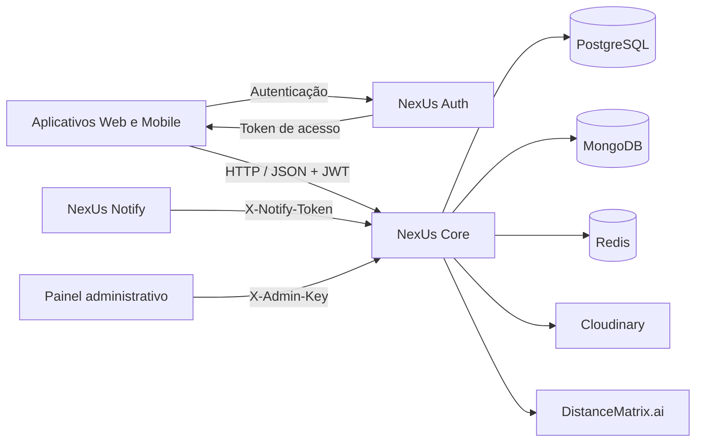

# NexUs Core

API responsável pelas operações centrais do ecossistema Ceris: perfis, estoque de alimentos, movimentações de consumo e descarte, empresas, lojas, planos, pagamentos, listas de compras e receitas salvas.

O serviço também mantém rankings de produtos, fornece candidatos a notificações para o NexUs Notify e disponibiliza métricas operacionais para o painel administrativo.

## Sumário

- [Visão geral](#visão-geral)
- [Arquitetura](#arquitetura)
- [Tecnologias](#tecnologias)
- [Requisitos](#requisitos)
- [Configuração](#configuração)
- [Execução local](#execução-local)
- [Execução com Docker](#execução-com-docker)
- [Autenticação e autorização](#autenticação-e-autorização)
- [Endpoints](#endpoints)
- [Regras de negócio](#regras-de-negócio)
- [Integração com o Notify](#integração-com-o-notify)
- [Rankings e cache](#rankings-e-cache)
- [Limitação de requisições](#limitação-de-requisições)
- [Rotinas agendadas](#rotinas-agendadas)
- [Observabilidade](#observabilidade)
- [Erros e respostas HTTP](#erros-e-respostas-http)
- [Testes e qualidade](#testes-e-qualidade)
- [Build e implantação](#build-e-implantação)
- [Estrutura do projeto](#estrutura-do-projeto)
- [Considerações operacionais](#considerações-operacionais)
- [Solução de problemas](#solução-de-problemas)
- [Licença](#licença)

## Visão geral

O NexUs Core oferece uma API HTTP com respostas em JSON para os aplicativos e serviços do Ceris.

Suas principais responsabilidades são:

| Área              | Recursos                                                                      |
| ----------------- | ----------------------------------------------------------------------------- |
| Perfis            | Consulta e atualização de dados, endereço, telefones e restrições alimentares |
| Imagens           | Upload e remoção da imagem do perfil e das lojas de uma empresa               |
| Estoque           | Cadastro de produtos e lotes, atualização de saldo, validade e estoque mínimo |
| Movimentações     | Registro de consumo e descarte com redução do saldo disponível                |
| Empresas          | Consulta da empresa autenticada e alteração de plano                          |
| Lojas             | Gestão de filiais, descoberta de lojas ativas e busca por proximidade         |
| Planos            | Consulta pública dos planos ativos                                            |
| Pagamentos        | Consulta de cobranças e registro de pagamento                                 |
| Listas de compras | Criação, atualização e gerenciamento de itens                                 |
| Receitas          | Consulta e remoção do vínculo de receitas salvas                              |
| Rankings          | Produtos cadastrados e vencidos, com recortes geográficos e diários           |
| Notificações      | Consulta interna de candidatos para processamento pelo Notify                 |
| Administração     | Verificação de chave administrativa e métricas do serviço                     |

A emissão e a renovação de tokens pertencem ao serviço de autenticação. O Core recebe e valida o token de acesso emitido por ele.

A geração de receitas e a gestão de eventos ficam fora da API pública deste serviço. O Core consulta receitas salvas e lê eventos do MongoDB para fornecer candidatos a notificações.

## Arquitetura



### Organização dos dados

| Armazenamento                 | Uso                                                                                                                      |
| ----------------------------- | ------------------------------------------------------------------------------------------------------------------------ |
| PostgreSQL                    | Perfis, endereços, empresas, lojas, planos, pagamentos, alimentos, categorias, estoque e configurações de estoque mínimo |
| PostgreSQL — schema `bi_hist` | Histórico de movimentações de consumo e descarte                                                                         |
| MongoDB                       | Listas de compras, receitas, vínculos de receitas salvas, registros de atividades e leitura de eventos                   |
| Redis                         | Rankings de produtos, controle de duplicidade dos eventos de ranking e cache de restrições alimentares                   |
| Cloudinary                    | Armazenamento das imagens enviadas pelas rotas de perfil e lojas                                                         |

O Core não possui integração direta com Neo4j nesta implementação.

## Tecnologias

| Tecnologia                        | Utilização                                |
| --------------------------------- | ----------------------------------------- |
| Java 17                           | Linguagem e ambiente de execução          |
| Spring Boot 4.1.0                 | Inicialização e configuração da aplicação |
| Spring MVC                        | API HTTP                                  |
| Spring Security                   | Segurança e autenticação                  |
| OAuth2 Resource Server            | Validação de JWT                          |
| Spring Data JPA / Hibernate       | Persistência relacional                   |
| Spring Data MongoDB               | Persistência documental                   |
| Spring Data Redis                 | Cache e rankings                          |
| Jakarta Validation                | Validação dos dados de entrada            |
| Springdoc OpenAPI                 | Documentação da API e Swagger UI          |
| Spring Boot Actuator / Micrometer | Saúde e métricas                          |
| Cloudinary SDK                    | Upload de imagens                         |
| Maven Wrapper                     | Build e execução                          |
| JUnit / Mockito / AssertJ         | Testes                                    |
| H2                                | Testes de persistência relacional         |
| Checkstyle                        | Verificação do padrão de código           |
| Docker / Docker Compose           | Execução em containers                    |

As versões das dependências estão definidas no `pom.xml`.

## Requisitos

Para executar a aplicação:

- JDK 17.
- Acesso a um PostgreSQL com o schema esperado pela aplicação.
- Acesso a um MongoDB.
- Acesso a um Redis.
- Chave JWT e emissor compatíveis com o NexUs Auth.

Conforme os recursos utilizados:

- Credenciais do DistanceMatrix.ai para geocodificação de endereços.
- Credenciais do Cloudinary para upload de imagens.
- Token compartilhado com o Notify.
- Chave administrativa para o painel e o endpoint Prometheus.
- Docker e Docker Compose, caso a execução seja feita por containers.

O Maven Wrapper permite executar os comandos sem instalar o Maven separadamente.

### Preparação do PostgreSQL

A aplicação utiliza:

```yaml
spring:
  jpa:
    hibernate:
      ddl-auto: validate
```

Isso significa que o Hibernate valida o schema existente, mas não cria nem atualiza as tabelas automaticamente.

Antes de iniciar o Core, aplique os scripts e migrations correspondentes do projeto NexUs-DB, incluindo:

- Tabelas, relacionamentos, constraints e dados de referência.
- Estrutura de planos compatível com o catálogo.
- Tabela `bi_hist.registro_estoque`.
- Função `fn_get_expiring_products`.
- Procedures `sp_generate_monthly_payments` e `sp_update_overdue_payments`.

A validação do Hibernate não substitui a verificação das funções e procedures usadas durante a execução.

## Configuração

Copie `.env.example` para `.env` na raiz do projeto e preencha os valores do seu ambiente.

**PowerShell:**

```powershell
Copy-Item .env.example .env
```

**Linux/macOS:**

```bash
cp .env.example .env
```

A aplicação também aceita variáveis de ambiente do processo e arquivos locais `.env.properties`, conforme os imports configurados no `application.yml`.

### Conexões e autenticação

| Variável                | Padrão                                  | Descrição                                                               |
| ----------------------- | --------------------------------------- | ----------------------------------------------------------------------- |
| `DB_URL`                | Sem padrão                              | URL JDBC do PostgreSQL                                                  |
| `DB_USERNAME`           | Sem padrão                              | Usuário do PostgreSQL                                                   |
| `DB_PASSWORD`           | Sem padrão                              | Senha do PostgreSQL                                                     |
| `MONGODB_URI`           | Sem padrão                              | URI de conexão com o MongoDB                                            |
| `MONGODB_DATABASE`      | Sem padrão na configuração da aplicação | Nome do banco MongoDB                                                   |
| `REDIS_URL`             | `redis://localhost:6379`                | URL do Redis                                                            |
| `REDIS_CONNECT_TIMEOUT` | `2s`                                    | Tempo máximo para estabelecer conexão com o Redis                       |
| `REDIS_TIMEOUT`         | `2s`                                    | Tempo máximo das operações Redis                                        |
| `JWT_SECRET_BASE64`     | Sem padrão                              | Chave de validação JWT, compartilhada com o Auth e codificada em Base64 |
| `JWT_ISSUER`            | `nexus-auth`                            | Emissor esperado no token                                               |
| `PORT`                  | `8080`                                  | Porta HTTP                                                              |
| `CORS_ALLOWED_ORIGINS`  | Vazio                                   | Origens permitidas, separadas por vírgulas                              |

A chave JWT deve representar pelo menos 32 bytes após a decodificação Base64.

Use a mesma chave e o mesmo emissor configurados no Auth. `JWT_SECRET_BASE64` é um segredo do servidor; o cliente envia o token de acesso, e não essa chave.

Exemplo de origens:

```dotenv
CORS_ALLOWED_ORIGINS=http://localhost:3000,http://localhost:5173
```

### Integrações

| Variável                 | Descrição                            |
| ------------------------ | ------------------------------------ |
| `DISTANCEMATRIX_API_KEY` | Chave da API de geocodificação       |
| `CLOUDINARY_CLOUD_NAME`  | Identificação do ambiente Cloudinary |
| `CLOUDINARY_API_KEY`     | Chave da API Cloudinary              |
| `CLOUDINARY_API_SECRET`  | Segredo da API Cloudinary            |
| `NOTIFY_CORE_TOKEN`      | Token compartilhado com o Notify     |

Sem credenciais Cloudinary, os uploads ficam indisponíveis e retornam `503`.

Sem um `NOTIFY_CORE_TOKEN` configurado, as chamadas às rotas internas de notificações não são autorizadas.

A geocodificação é necessária nas operações de endereço que precisam resolver novas coordenadas.

### Administração e cache

| Variável                                         | Padrão  | Descrição                                   |
| ------------------------------------------------ | ------- | ------------------------------------------- |
| `ADMIN_API_KEY`                                  | Vazio   | Chave de acesso administrativo              |
| `ADMIN_METRICS_STEP_MS`                          | `60000` | Intervalo entre amostras de métricas        |
| `ADMIN_METRICS_RETENTION_MINUTES`                | `720`   | Retenção das amostras em memória            |
| `PROFILE_DIETARY_RESTRICTIONS_CACHE_TTL_SECONDS` | `86400` | Validade do cache de restrições alimentares |

`TRACING_ACESS` é aceito como alternativa de compatibilidade para a chave administrativa. Para novas configurações, utilize `ADMIN_API_KEY`.

### Rate limit

| Variável                            | Padrão   | Descrição                                               |
| ----------------------------------- | -------- | ------------------------------------------------------- |
| `RATE_LIMIT_REQUESTS_PER_MINUTE`    | `120`    | Cota geral por perfil autenticado                       |
| `RATE_LIMIT_WRITES_PER_MINUTE`      | `30`     | Cota de escrita por perfil                              |
| `RATE_LIMIT_INTEGRATION_PER_MINUTE` | `600`    | Cota compartilhada das chamadas autenticadas do Notify  |
| `RATE_LIMIT_MAX_ENTRIES`            | `100000` | Capacidade máxima da estrutura de contadores            |
| `RATE_LIMIT_TRUSTED_PROXIES`        | Vazio    | Proxies confiáveis usados para resolver o IP do cliente |

### Cobrança e agendamento

| Variável                        | Padrão              | Descrição                                |
| ------------------------------- | ------------------- | ---------------------------------------- |
| `BUSINESS_TIME_ZONE`            | `America/Sao_Paulo` | Fuso utilizado pelas rotinas de cobrança |
| `BILLING_DUE_DAY`               | `10`                | Dia de vencimento, entre 1 e 28          |
| `BILLING_GRACE_DAYS`            | `0`                 | Tolerância para inadimplência, em dias   |
| `BILLING_MONTHLY_PAYMENTS_CRON` | `0 10 0 1 * *`      | Geração mensal de cobranças              |
| `BILLING_OVERDUE_PAYMENTS_CRON` | `0 15 0 * * *`      | Atualização de pagamentos vencidos       |

Os cronogramas utilizam o formato Spring, com seis campos, começando pelos segundos.

## Execução local

### 1. Obtenha o projeto

```bash
git clone https://github.com/NexUs-ofc/NexUs-Core.git
cd NexUs-Core
```

### 2. Prepare os serviços de dados

Configure PostgreSQL, MongoDB e Redis acessíveis a partir da máquina em que o Java será executado.

Para disponibilizar um Redis local com Docker:

```bash
docker run --name nexus-core-redis -d -p 127.0.0.1:6379:6379 redis:7-alpine
```

Nesse cenário:

```dotenv
REDIS_URL=redis://localhost:6379
```

O PostgreSQL deve estar previamente preparado com o schema e as rotinas necessárias.

### 3. Configure o ambiente

Preencha o `.env` com as conexões, a configuração JWT e as integrações necessárias.

### 4. Inicie a aplicação

**PowerShell:**

```powershell
.\mvnw.cmd spring-boot:run
```

**Linux/macOS:**

```bash
./mvnw spring-boot:run
```

Por padrão, a API ficará disponível em:

```text
http://localhost:8080
```

### 5. Verifique a inicialização

```bash
curl http://localhost:8080/actuator/health
```

O endpoint de saúde não exige JWT. A verificação de saúde do MongoDB está desabilitada na configuração atual; portanto, esse resultado não confirma sozinho a disponibilidade de todas as dependências.

## Execução com Docker

O `docker-compose.yml` define:

- O container `nexus-core`.
- Um Redis com persistência AOF e volume.
- A publicação da porta HTTP do Core.
- A dependência da aplicação em relação à saúde do Redis.

PostgreSQL e MongoDB devem ser fornecidos separadamente.

### Configuração básica

Preencha o `.env` e utilize o endereço do Redis dentro da rede Docker:

```dotenv
REDIS_URL=redis://redis:6379
```

Inicie os serviços:

```bash
docker compose up --build
```

Acompanhe os logs:

```bash
docker compose logs -f nexus-core
```

Encerre os containers:

```bash
docker compose down
```

### Variáveis adicionais no container

O Compose encaminha explicitamente apenas parte das variáveis da aplicação. A existência de uma variável no `.env` não significa que ela será automaticamente enviada ao container.

Para disponibilizar também as credenciais Cloudinary, o token Notify e outras configurações, crie um arquivo local `compose.local.yml`:

```yaml
services:
  nexus-core:
    env_file:
      - .env
```

Execute:

```bash
docker compose -f docker-compose.yml -f compose.local.yml up --build
```

Os valores definidos no bloco `environment` do Compose continuam tendo prioridade sobre `env_file`.

Dentro do container, `localhost` aponta para o próprio container. Utilize endereços de rede acessíveis para PostgreSQL e MongoDB.

## Autenticação e autorização

### API do aplicativo

As rotas protegidas recebem:

```http
Authorization: Bearer <ACCESS_TOKEN>
```

O Core valida o token localmente com:

- Assinatura HS256.
- Chave compartilhada com o Auth.
- Emissor configurado em `JWT_ISSUER`.
- Validações temporais do JWT.

O `sub` identifica o perfil autenticado e deve conter um identificador numérico. A claim `profile_type` é convertida em uma autoridade com prefixo `ROLE_`.

Tipos de perfil definidos no domínio:

```text
HOUSEHOLD
ADMIN
COMPANY
STORE
```

A autorização também depende das regras dos serviços, como a verificação de propriedade do estoque, da lista de compras ou da loja.

As operações em `/api/companies/me/**` exigem um perfil do tipo `COMPANY`.

### Acesso público

As seguintes rotas dispensam JWT:

- `GET /api/plans`
- `/actuator/health/**`
- `/swagger-ui.html`
- `/swagger-ui/**`
- `/v3/api-docs/**`

As consultas de lojas em `/api/stores/**` exigem autenticação.

### Integração Notify

As rotas `/internal/notifications/**` utilizam:

```http
X-Notify-Token: <NOTIFY_CORE_TOKEN>
```

### Administração

As rotas administrativas utilizam:

```http
X-Admin-Key: <ADMIN_API_KEY>
```

Cada credencial atende a um fluxo específico. O JWT de usuário não substitui a chave administrativa nem o token de integração.

### Política de tokens

O Core opera sem sessão de usuário no servidor e não consulta o Auth a cada requisição.

A validação criptográfica do token não oferece revogação imediata. Logout, alterações de permissões ou mudanças cadastrais não invalidam automaticamente um JWT já emitido no Core. As verificações adicionais de estado e propriedade dependem de cada operação.

## Endpoints

Os caminhos abaixo são relativos à URL base da aplicação.

Os formatos detalhados de entrada e saída podem ser consultados na documentação OpenAPI configurada em:

```text
/swagger-ui/index.html
/v3/api-docs
```

No Swagger, informe apenas o JWT no esquema `BearerAuth`, sem escrever o prefixo `Bearer`.

### Perfil

| Método   | Rota                 | Descrição                              |
| -------- | -------------------- | -------------------------------------- |
| `GET`    | `/api/profile`       | Consulta o perfil autenticado          |
| `PATCH`  | `/api/profile`       | Atualiza os dados do perfil            |
| `PUT`    | `/api/profile/image` | Envia a imagem do perfil               |
| `DELETE` | `/api/profile/image` | Remove a referência à imagem do perfil |

### Estoque e alimentos

| Método   | Rota                            | Descrição                                                      |
| -------- | ------------------------------- | -------------------------------------------------------------- |
| `GET`    | `/api/stock`                    | Lista os lotes com saldo positivo                              |
| `POST`   | `/api/stock`                    | Adiciona um lote de alimento já cadastrado                     |
| `PATCH`  | `/api/stock/{id}`               | Atualiza quantidade e/ou validade                              |
| `DELETE` | `/api/stock/{id}`               | Zera o saldo do lote                                           |
| `GET`    | `/api/stock/expired`            | Lista lotes vencidos com saldo positivo                        |
| `GET`    | `/api/stock/missing`            | Lista produtos abaixo do mínimo configurado                    |
| `GET`    | `/api/stock/foods?search=...`   | Consulta o catálogo de alimentos                               |
| `GET`    | `/api/stock/settings`           | Lista configurações de estoque mínimo                          |
| `PUT`    | `/api/stock/settings/{foodId}`  | Define ou remove o estoque mínimo                              |
| `POST`   | `/api/foods`                    | Cadastra ou reutiliza um alimento pelo GTIN e adiciona um lote |
| `POST`   | `/api/foods/batch`              | Registra uma lista de produtos                                 |
| `POST`   | `/api/stock/{itemId}/movements` | Registra consumo ou descarte                                   |

### Empresas, planos e pagamentos

| Método  | Rota                                  | Descrição                       |
| ------- | ------------------------------------- | ------------------------------- |
| `GET`   | `/api/plans`                          | Lista pública dos planos ativos |
| `GET`   | `/api/companies/me`                   | Consulta a empresa autenticada  |
| `PATCH` | `/api/companies/me/plan`              | Altera o plano da empresa       |
| `GET`   | `/api/companies/me/payments`          | Lista cobranças da empresa      |
| `GET`   | `/api/companies/me/payments/{id}`     | Consulta uma cobrança           |
| `POST`  | `/api/companies/me/payments/{id}/pay` | Registra a cobrança como paga   |

A listagem de pagamentos aceita o filtro `status`:

```text
PENDING
PAID
OVERDUE
CANCELLED
```

Exemplo:

```http
GET /api/companies/me/payments?status=PENDING
```

### Lojas

| Método   | Rota                                  | Descrição                                             |
| -------- | ------------------------------------- | ----------------------------------------------------- |
| `GET`    | `/api/stores`                         | Lista lojas com os perfis da loja e da empresa ativos |
| `GET`    | `/api/stores/{id}`                    | Consulta uma loja disponível                          |
| `GET`    | `/api/stores/nearby`                  | Busca lojas por proximidade                           |
| `GET`    | `/api/companies/me/stores`            | Lista as lojas da empresa autenticada                 |
| `POST`   | `/api/companies/me/stores`            | Cria uma loja vinculada à empresa                     |
| `GET`    | `/api/companies/me/stores/{id}`       | Consulta uma loja da empresa                          |
| `PATCH`  | `/api/companies/me/stores/{id}`       | Atualiza uma loja da empresa                          |
| `DELETE` | `/api/companies/me/stores/{id}`       | Remove uma loja da empresa                            |
| `PUT`    | `/api/companies/me/stores/{id}/image` | Envia a imagem da loja                                |
| `DELETE` | `/api/companies/me/stores/{id}/image` | Remove a referência à imagem da loja                  |

`/api/stores` atende à descoberta de lojas. `/api/companies/me/stores` atende à gestão das lojas pertencentes à empresa autenticada.

Essas listagens retornam arrays e não oferecem paginação nesta implementação.

### Listas de compras

| Método   | Rota                                      | Descrição                 |
| -------- | ----------------------------------------- | ------------------------- |
| `GET`    | `/api/shopping-lists`                     | Lista as listas do perfil |
| `POST`   | `/api/shopping-lists`                     | Cria uma lista            |
| `GET`    | `/api/shopping-lists/{id}`                | Consulta uma lista        |
| `PUT`    | `/api/shopping-lists/{id}`                | Atualiza título e data    |
| `DELETE` | `/api/shopping-lists/{id}`                | Exclui uma lista          |
| `POST`   | `/api/shopping-lists/{id}/items`          | Adiciona um item          |
| `PATCH`  | `/api/shopping-lists/{id}/items/{itemId}` | Atualiza um item          |
| `DELETE` | `/api/shopping-lists/{id}/items/{itemId}` | Remove um item            |

### Receitas salvas

| Método   | Rota                | Descrição                                      |
| -------- | ------------------- | ---------------------------------------------- |
| `GET`    | `/api/recipes`      | Lista receitas salvas                          |
| `GET`    | `/api/recipes/{id}` | Consulta uma receita salva acessível ao perfil |
| `DELETE` | `/api/recipes/{id}` | Remove o vínculo da receita com o perfil       |

A remoção de uma receita salva não representa a exclusão global do documento compartilhado.

### Rankings

| Método | Rota                                 | Descrição                      |
| ------ | ------------------------------------ | ------------------------------ |
| `GET`  | `/api/rankings/products/{eventType}` | Consulta o ranking de produtos |

Tipos aceitos:

```text
registered
expired
```

Parâmetros opcionais:

| Parâmetro | Descrição                                                       |
| --------- | --------------------------------------------------------------- |
| `state`   | UF com duas letras                                              |
| `city`    | Cidade; exige `state`                                           |
| `date`    | Data no formato `YYYY-MM-DD`; exige `state` e não aceita `city` |
| `limit`   | Quantidade de resultados, entre 1 e 100; padrão 10              |

Exemplo:

```http
GET /api/rankings/products/registered?state=SP&city=São%20Paulo&limit=10
```

### Exemplos de uso

Consulta do perfil:

```bash
curl "http://localhost:8080/api/profile" \
  -H "Authorization: Bearer <ACCESS_TOKEN>"
```

Adição de um lote de alimento já existente:

```http
POST /api/stock
Authorization: Bearer <ACCESS_TOKEN>
Content-Type: application/json

{
  "foodId": 123,
  "quantity": 3,
  "expiryDate": "2026-12-10"
}
```

Registro de consumo:

```http
POST /api/stock/456/movements
Authorization: Bearer <ACCESS_TOKEN>
Content-Type: application/json

{
  "type": "CONSUMED",
  "quantity": 1
}
```

Definição de estoque mínimo:

```http
PUT /api/stock/settings/123
Authorization: Bearer <ACCESS_TOKEN>
Content-Type: application/json

{
  "minimumQuantity": 2
}
```

Upload de imagem:

```bash
curl -X PUT "http://localhost:8080/api/profile/image" \
  -H "Authorization: Bearer <ACCESS_TOKEN>" \
  -F "file=@perfil.png"
```

Os identificadores dos exemplos devem ser substituídos por recursos existentes e acessíveis ao perfil autenticado. Em PowerShell, utilize `curl.exe` caso `curl` esteja associado a outro comando.

## Regras de negócio

### Alimentos e lotes

- O alimento representa o produto do catálogo.
- O lote representa uma quantidade desse alimento no estoque de um perfil.
- Um alimento pode estar associado a vários lotes, com validades diferentes.
- O cadastro por GTIN reutiliza o alimento quando ele já existe.
- Para criar um alimento novo, é necessário um código GPC alimentar reconhecido.
- O GTIN deve conter 8, 12, 13 ou 14 dígitos.
- As unidades definidas no domínio são `g`, `kg`, `ml`, `l` e `unit`.
- O cadastro em lote aceita de 1 a 100 produtos.

### Saldo, consumo e descarte

- A listagem principal do estoque considera lotes com quantidade maior que zero.
- Um lote é considerado vencido quando sua validade é anterior à data atual.
- A exclusão de um lote pela API zera sua quantidade.
- Consumo e descarte devem ser registrados como movimentações `CONSUMED` ou `DISCARDED`.
- Uma movimentação exige quantidade positiva e não pode superar o saldo disponível.
- A redução do saldo e a gravação da movimentação ocorrem na mesma transação relacional.
- As alterações concorrentes utilizam bloqueio do lote no banco.

Atualizar diretamente a quantidade ou zerar um lote não equivale a registrar uma movimentação de consumo ou descarte.

### Estoque mínimo

O mínimo é configurado por perfil e alimento.

Enviar `minimumQuantity: 0` remove a configuração.

Na implementação documentada, a consulta de produtos faltantes soma os saldos dos lotes sem excluir os vencidos. A alteração dessa regra precisa estar integrada à versão utilizada antes de ser considerada disponível.

### Empresas e planos

- A empresa só pode gerenciar seus próprios recursos.
- A contratação aceita apenas planos ativos.
- O catálogo público retorna planos ativos ordenados por preço e identificador.
- Não há aplicação de um limite de lojas por plano nesta versão.

### Pagamentos

A rota de pagamento altera o estado da cobrança no banco e registra a data do pagamento.

Não existe integração com um gateway financeiro nessa operação. Ela não processa cartão, Pix, boleto ou transferência.

Cobranças já pagas ou canceladas não podem ser pagas novamente.

### Geolocalização

A busca de lojas próximas aceita:

```http
GET /api/stores/nearby?latitude=-23.5505&longitude=-46.6333&radiusKm=5
```

- Latitude e longitude devem ser informadas juntas.
- Sem coordenadas na requisição, utiliza-se o endereço do perfil autenticado.
- O raio padrão é 5 km.
- O raio permitido é maior que zero e de até 100 km.
- Operações que precisam de novas coordenadas consultam o DistanceMatrix.ai.

### Imagens

- O arquivo é enviado em `multipart/form-data`, no campo `file`.
- Os formatos aceitos são JPEG, PNG e WebP.
- O tamanho máximo do arquivo é 5 MB.
- A imagem pode ter até 16 megapixels.
- O perfil de destino deve estar ativo e ser `HOUSEHOLD`, `STORE` ou `COMPANY`.
- A empresa só pode alterar imagens de lojas próprias.

A remoção limpa a URL do perfil no banco. Ela não exclui o arquivo armazenado no Cloudinary.

## Integração com o Notify

O Core fornece dados elegíveis para o Notify. O envio e a gestão das notificações pertencem ao serviço consumidor.

Todas as rotas abaixo exigem `X-Notify-Token`.

| Método | Rota                                     | Finalidade                              |
| ------ | ---------------------------------------- | --------------------------------------- |
| `GET`  | `/internal/notifications/products`       | Produtos no intervalo de validade       |
| `GET`  | `/internal/notifications/events`         | Eventos no intervalo informado          |
| `GET`  | `/internal/notifications/shopping-lists` | Listas de compras com data no intervalo |
| `GET`  | `/internal/notifications/nearby-stores`  | Lojas próximas de perfis elegíveis      |
| `GET`  | `/internal/notifications/new-stores`     | Novas lojas e perfis próximos           |

### Parâmetros

- `from` e `to`: datas no formato `YYYY-MM-DD`, quando aplicáveis.
- `page`: índice da página, começando em `0`.
- `size`: tamanho da página, padrão `100`, entre `1` e `500`.
- `radiusKm`: raio das consultas geográficas, padrão `5`, maior que zero e até `100`.

A diferença entre `from` e `to` pode ser de até 31 dias.

As respostas possuem:

```json
{
  "content": [],
  "hasNext": false
}
```

O consumidor deve continuar a paginação enquanto `hasNext` for `true`, mesmo quando uma página retornar `content` vazio, pois alguns filtros são aplicados depois da consulta paginada.

Os eventos são lidos da coleção `events`. Na consulta de eventos, os limites das datas são convertidos para UTC.

## Rankings e cache

### Rankings de produtos

Os rankings utilizam Sorted Sets do Redis.

Cada lote contribui uma vez para cada tipo de evento:

- `registered`: cadastro do lote.
- `expired`: identificação do vencimento do lote.

A pontuação representa a quantidade de eventos contabilizados, e não a soma das unidades ou do peso dos produtos.

Principais formatos de chave:

```text
ranking:product:{eventType}:all
ranking:product:{eventType}:state:{UF}
ranking:product:{eventType}:city:{UF}:{cidade-normalizada}
ranking:product:{eventType}:day:{YYYY-MM-DD}:state:{UF}

ranking:event:{eventType}:{pantryItemId}
```

Os rankings diários possuem expiração de 90 dias. Os acumulados e os marcadores de duplicidade não possuem expiração definida nessa implementação.

### Restrições alimentares

O cache utiliza as chaves:

```text
profile:{profileId}:dietary_restrictions
profile:{profileId}:dietary_restrictions:version
```

O TTL padrão é de 24 horas.

A alteração das restrições invalida o cache após o commit da transação. Se o Redis estiver indisponível durante a consulta desse cache, o serviço busca os dados persistidos.

Esse comportamento de fallback não deve ser generalizado para os rankings, que dependem diretamente do Redis.

## Limitação de requisições

O rate limit é mantido em memória em cada instância do Core.

| Fluxo                                          | Limite padrão  | Identificação              |
| ---------------------------------------------- | -------------- | -------------------------- |
| Chamadas autenticadas em `/api/**`             | 120 por minuto | Perfil                     |
| Escritas com `POST`, `PUT`, `PATCH` e `DELETE` | 30 por minuto  | Perfil, além da cota geral |
| Consulta anônima de `GET /api/plans`           | 120 por minuto | IP                         |
| Chamadas internas autenticadas do Notify       | 600 por minuto | Integração compartilhada   |

As cotas de escrita e geral se acumulam. Uma escrita precisa respeitar ambas.

Ao exceder uma cota:

```http
HTTP/1.1 429 Too Many Requests
Retry-After: <segundos>
Content-Type: application/json
```

```json
{
  "code": "RATE_LIMIT_EXCEEDED",
  "message": "Muitas requisicoes. Tente novamente mais tarde."
}
```

Requisições `OPTIONS` e os endpoints de saúde ficam fora dessas cotas.

Como os contadores são locais:

- Reiniciar o processo zera os contadores.
- Réplicas diferentes possuem cotas independentes.
- Os limites não são compartilhados pelo Redis.

Configure os proxies confiáveis conforme a infraestrutura utilizada para que a resolução do IP não dependa de cabeçalhos arbitrários enviados pelo cliente.

## Rotinas agendadas

| Rotina                             | Execução padrão       | Comportamento                                                |
| ---------------------------------- | --------------------- | ------------------------------------------------------------ |
| Geração mensal de cobranças        | Dia 1, às 00:10       | Executa `sp_generate_monthly_payments`                       |
| Atualização de inadimplência       | Diariamente, às 00:15 | Executa `sp_update_overdue_payments`                         |
| Identificação de produtos vencidos | Diariamente, às 00:05 | Atualiza o ranking de vencidos em lotes de até 500 registros |
| Amostragem administrativa          | A cada 60 segundos    | Mantém o histórico local de métricas                         |

As rotinas de cobrança usam `BUSINESS_TIME_ZONE`.

A varredura de vencidos utiliza o fuso padrão da JVM e pode ter o cronograma sobrescrito pela propriedade `app.rankings.expired-scan-cron`.

Em uma implantação com várias réplicas, os agendamentos podem executar em todas elas. As rotinas do banco devem estar preparadas para chamadas concorrentes ou repetidas.

## Observabilidade

### Saúde

```text
GET /actuator/health
GET /actuator/health/liveness
GET /actuator/health/readiness
```

Esses endpoints não exigem autenticação.

### Administração

| Rota                            | Finalidade                           |
| ------------------------------- | ------------------------------------ |
| `GET /admin/session`            | Verifica a chave administrativa      |
| `GET /admin/metrics?minutos=60` | Retorna métricas para o painel       |
| `GET /actuator/prometheus`      | Expõe métricas no formato Prometheus |

Exemplo:

```bash
curl "http://localhost:8080/admin/metrics?minutos=60" \
  -H "X-Admin-Key: <ADMIN_API_KEY>"
```

As métricas incluem:

- Volume de requisições por endpoint.
- Distribuição de status e taxa de erros.
- Latências e endpoints mais lentos.
- Memória, CPU, garbage collection e threads.
- Tempo de atividade.
- Conexões do pool PostgreSQL.
- Contagem de eventos de log em nível de erro.

O histórico administrativo permanece em memória e recomeça após o reinício do processo. Em múltiplas réplicas, cada instância mantém suas próprias amostras.

Para histórico centralizado e persistente, é necessário um coletor externo.

O endpoint Prometheus também aceita a chave no parâmetro `key`, por compatibilidade com coletores. O header `X-Admin-Key` está disponível para os clientes que o suportam.

Detalhes do contrato estão no [guia do painel administrativo](https://github.com/NexUs-ofc/NexUs-Core/blob/main/docs/painel-admin.md).

## Erros e respostas HTTP

Os erros tratados pelo handler da aplicação seguem este formato:

```json
{
  "timestamp": "2026-11-02T12:00:00Z",
  "status": 400,
  "error": "Bad Request",
  "message": "Descrição do problema"
}
```

| Status | Uso                                                                             |
| ------ | ------------------------------------------------------------------------------- |
| `200`  | Consulta ou alteração concluída                                                 |
| `201`  | Recurso criado                                                                  |
| `204`  | Operação concluída sem corpo                                                    |
| `400`  | Entrada inválida ou regra de negócio rejeitada                                  |
| `401`  | Credencial ausente ou inválida                                                  |
| `403`  | Operação não permitida                                                          |
| `404`  | Recurso não encontrado ou não acessível no contexto da operação                 |
| `413`  | Upload acima do tamanho permitido                                               |
| `429`  | Limite de requisições excedido                                                  |
| `500`  | Falha interna, incluindo erros de acesso a dados tratados pelo handler          |
| `502`  | Falha de comunicação com o Cloudinary                                           |
| `503`  | Recurso indisponível por ausência de configuração, como upload ou administração |

As respostas geradas pelos filtros de segurança e rate limit podem utilizar formatos diferentes. O cliente deve verificar o status HTTP e não assumir que todo erro terá o mesmo corpo.

## Testes e qualidade

### Testes padrão

**PowerShell:**

```powershell
.\mvnw.cmd test
```

**Linux/macOS:**

```bash
./mvnw test
```

### Testes com MongoDB real

Alguns testes de persistência só são habilitados quando a propriedade `mongodb.test.uri` é informada.

Disponibilize uma instância exclusiva para testes:

```bash
docker run --name nexus-core-mongo-test -d -p 127.0.0.1:27017:27017 mongo:8.2
```

**PowerShell:**

```powershell
.\mvnw.cmd test "-Dmongodb.test.uri=mongodb://localhost:27017"
```

**Linux/macOS:**

```bash
./mvnw test -Dmongodb.test.uri=mongodb://localhost:27017
```

Sem essa propriedade, os testes condicionais de MongoDB não são executados.

### Verificação de estilo

```powershell
.\mvnw.cmd checkstyle:check
```

```bash
./mvnw checkstyle:check
```

### Verificação conjunta

```powershell
.\mvnw.cmd clean verify checkstyle:check "-Dmongodb.test.uri=mongodb://localhost:27017"
```

```bash
./mvnw clean verify checkstyle:check -Dmongodb.test.uri=mongodb://localhost:27017
```

A suíte cobre regras de serviços, segurança, rate limit, contratos HTTP, imagens, geocodificação e persistência.

Parte dos testes relacionais utiliza H2 em modo de compatibilidade PostgreSQL. Eles não substituem a validação das funções, procedures e migrations no PostgreSQL do ambiente.

## Build e implantação

### Gerar o JAR

**PowerShell:**

```powershell
.\mvnw.cmd clean package
java -jar target/NexUs-Core-0.0.1-SNAPSHOT.jar
```

**Linux/macOS:**

```bash
./mvnw clean package
java -jar target/NexUs-Core-0.0.1-SNAPSHOT.jar
```

O nome do artefato acompanha a versão definida no `pom.xml`.

### Imagem Docker

O projeto utiliza `Dockerfile.vercel` como arquivo de build da imagem:

```bash
docker build -f Dockerfile.vercel -t nexus-core:local .
```

O build é realizado em múltiplos estágios. A imagem final utiliza Java 17 e executa a aplicação com um usuário sem privilégios de root.

As credenciais devem ser fornecidas no ambiente de execução.

### Integração contínua

Os workflows do GitHub Actions incluem:

- Testes com Java 17.
- MongoDB real para testes de persistência.
- Checkstyle.
- Compilação e empacotamento.

### AWS ECR / EKS

O workflow principal possui implantação no EKS após um push na `main`, condicionada à aprovação dos jobs de testes, estilo e build.

Esse fluxo depende das credenciais AWS, do repositório ECR, do cluster, do namespace e do Deployment previamente configurados.

O manifesto Kubernetes define duas réplicas, probes de saúde e leitura das variáveis a partir do Secret `nexus-core-secret`.

### Discloud

O projeto também possui configuração para publicação do JAR na Discloud.

O workflow:

- Valida o empacotamento em pull requests.
- Publica em pushes na `main` ou execução manual.
- Utiliza o secret `DISCLOUD_TOKEN`.
- Envia `app.jar` e `discloud.config`.

O workflow da Discloud é separado do pipeline de implantação no EKS.

## Estrutura do projeto

```text
NexUs-Core/
├── .github/workflows/        # Testes, build e implantação
├── .mvn/                     # Maven Wrapper
├── config/                   # Checkstyle
├── docs/                     # Documentação complementar
├── k8s/                      # Manifestos Kubernetes
├── src/
│   ├── main/
│   │   ├── java/com/example/nexuscore/
│   │   │   ├── admin/        # Autenticação e métricas administrativas
│   │   │   ├── annotations/  # Anotações de validação
│   │   │   ├── categorization/
│   │   │   ├── config/       # Segurança e configuração
│   │   │   ├── controller/   # Endpoints HTTP
│   │   │   ├── converter/
│   │   │   ├── dto/          # Contratos de entrada e saída
│   │   │   ├── exception/    # Erros e tratamento de exceções
│   │   │   ├── geo/          # Geocodificação
│   │   │   ├── image/        # Validação e armazenamento de imagens
│   │   │   ├── mapper/
│   │   │   ├── model/        # Entidades e documentos
│   │   │   ├── ratelimit/
│   │   │   ├── repository/
│   │   │   ├── service/      # Regras de negócio e agendamentos
│   │   │   └── util/
│   │   └── resources/
│   │       ├── application.yml
│   │       └── categorization/
│   └── test/
├── .env.example
├── Dockerfile.vercel
├── docker-compose.yml
├── discloud.config
├── ceris-logical-model.dbml
├── pom.xml
└── LICENSE
```

## Considerações operacionais

- O schema PostgreSQL é gerenciado externamente; o Core não executa migrations automaticamente.
- Operações envolvendo PostgreSQL, MongoDB, Redis e Cloudinary não constituem uma única transação distribuída.
- Uma falha em uma integração pode ocorrer depois de outra persistência já ter sido concluída. A repetição de escritas exige atenção ao estado final do recurso.
- Rankings acumulados e marcadores de duplicidade no Redis precisam de persistência e planejamento de retenção.
- Os contadores de rate limit e as amostras administrativas são locais a cada instância.
- A exclusão de uma imagem do perfil não remove o arquivo do Cloudinary.
- A rota de pagamento registra uma mudança de estado; não realiza uma transação financeira.
- A ausência de erro no endpoint de saúde não comprova o funcionamento de todas as integrações.
- A configuração do fuso da JVM deve ser coerente com as regras de validade e os agendamentos usados no ambiente.

## Solução de problemas

| Sintoma                                                | Verificação                                                            |
| ------------------------------------------------------ | ---------------------------------------------------------------------- |
| Falha ao iniciar por incompatibilidade de schema       | Confira as migrations e o schema PostgreSQL esperado pelas entidades   |
| `401` nas rotas do aplicativo                          | Confira validade do JWT, emissor e chave compartilhada com o Auth      |
| `401` nas rotas internas                               | Confira `X-Notify-Token` e `NOTIFY_CORE_TOKEN`                         |
| `401` no painel                                        | Confira `X-Admin-Key`                                                  |
| `503` no painel                                        | Configure `ADMIN_API_KEY`                                              |
| `503` no upload                                        | Configure as três credenciais Cloudinary                               |
| `502` no upload                                        | Confira credenciais, conectividade e resposta do Cloudinary            |
| Falha ao salvar um endereço                            | Confira a chave de geocodificação e a resposta do provedor             |
| Erro de CORS                                           | Inclua a origem exata do navegador em `CORS_ALLOWED_ORIGINS`           |
| `429`                                                  | Respeite o tempo informado em `Retry-After`                            |
| Ranking vazio                                          | Confira o recorte consultado e se existem eventos registrados no Redis |
| Recursos funcionam localmente, mas falham no container | Confira quais variáveis foram efetivamente encaminhadas pelo Compose   |
| Testes MongoDB ignorados                               | Informe `mongodb.test.uri`                                             |
| Falha nas rotinas de cobrança                          | Confira a existência e a assinatura das procedures no PostgreSQL       |

## Licença

Distribuído sob a [licença MIT](https://github.com/NexUs-ofc/NexUs-Core/blob/main/LICENSE).

Copyright © 2026 NexUs.
